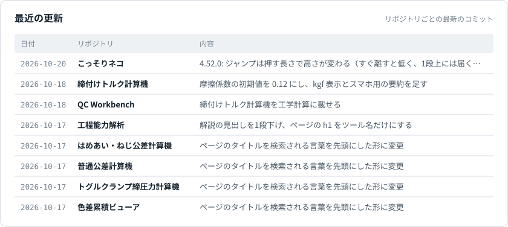

<!-- このファイルは scripts/render.mjs が自動で作ります。直接は編集せず、profile.config.json か scripts/ を直してください -->

<a href="https://linktr.ee/kotaooka"><picture><source media="(prefers-color-scheme: dark)" srcset="./assets/hero-dark.svg"></picture></a>

<a href="https://kotaooka.github.io/"><picture><source media="(prefers-color-scheme: dark)" srcset="./assets/portal-dark.svg"></picture></a>

### 最近作ったツール

<a href="https://kotaooka.github.io/fit-calc/"><picture><source media="(prefers-color-scheme: dark)" srcset="./assets/tool-fit-calc-dark.svg"></picture></a>
<a href="https://kotaooka.github.io/clamp-calc/"><picture><source media="(prefers-color-scheme: dark)" srcset="./assets/tool-clamp-calc-dark.svg"></picture></a>
<a href="https://kotaooka.github.io/triangle-calc/"><picture><source media="(prefers-color-scheme: dark)" srcset="./assets/tool-triangle-calc-dark.svg"></picture></a>

 

<picture><source media="(prefers-color-scheme: dark)" srcset="./assets/stats-dark.svg"></picture>

<picture><source media="(prefers-color-scheme: dark)" srcset="./assets/history-dark.svg"></picture>

